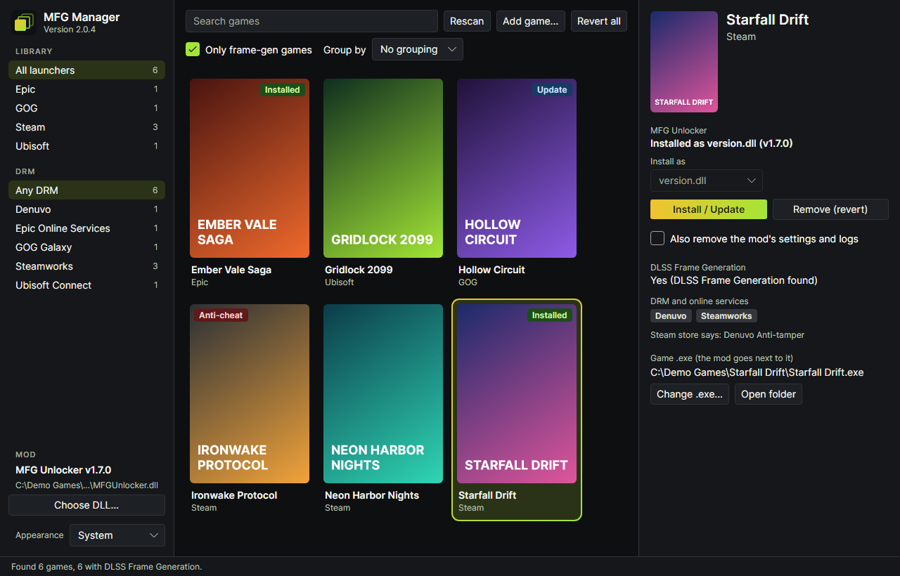
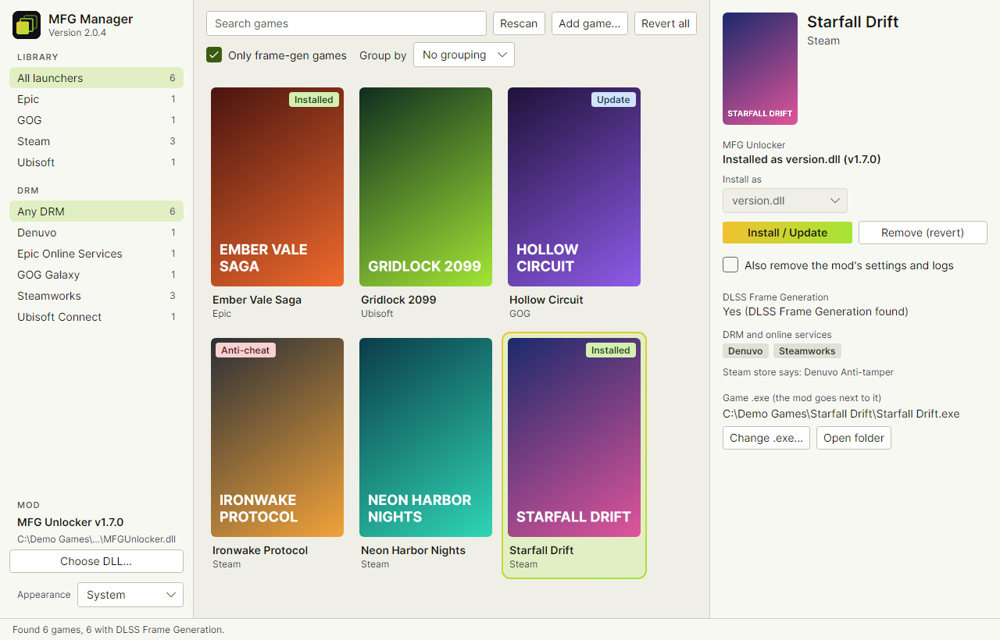

# MFG Manager

A desktop app that finds your games, shows which ones have DLSS Frame Generation, and installs or removes the
[MFG Unlocker](https://github.com/dashdogy/MFG-Unlocker) mod with one click.

| Dark | Light |
|---|---|
|  |  |

*The games in these pictures are made up.*

> **Unofficial.** This project isn't affiliated with or endorsed by NVIDIA, the author of MFG Unlocker, Valve, or any game or launcher mentioned here. All trademarks belong to their owners.

## Read this first

- **Anti-cheat can get you banned.** Anti-cheat systems can treat the mod as a cheat. The app warns you before installing into a game where it finds anti-cheat, but it can't find every kind. Don't play online with the mod installed. Using it is at your own risk.
- **The mod isn't included.** MFG Manager uses a copy you already have, or downloads the official release from the mod's GitHub page when you click. It checks the download against the SHA-256 fingerprint GitHub lists for it. That proves the file is the one published there, not that it's safe.
- **It asks for admin rights on Windows,** because game folders under Program Files can't be changed without them.
- **The installer isn't code-signed,** so Windows may warn about an unknown publisher. An app that runs as admin and places files like `version.dll` in game folders can also look suspicious to antivirus tools. Build it from source if you'd rather check it yourself.
- **Linux is experimental.** It builds and its code paths are tested, but it hasn't been run on a real Linux desktop yet.

## What it does

- Finds games from Steam, Ubisoft Connect, Epic, GOG, Xbox, Battle.net, EA app and Rockstar on Windows, and from Steam and Heroic on Linux. Anything else can be added by hand.
- Shows covers, Frame Generation support, anti-cheat and DRM for each game, with search, filters and grouping.
- Installs the mod under a file name the game will load, and never overwrites a file that belongs to the game.
- Removes the mod again, from one game or from all of them, and only deletes a file after checking that it really is the mod.
- Tells you when a newer mod version is out, and has light and dark mode.

## Privacy

No accounts, no telemetry and no background activity. The app only talks to two services: GitHub, to check for and download mod releases, and Steam's public store, for covers and DRM information. To look up a game that isn't on Steam on your PC, it sends the game's name to Steam's store search. It sends nothing else about you.

## Install

### Windows

Needs Windows 10 or 11 and the [.NET 10 Runtime](https://dotnet.microsoft.com/download/dotnet/10.0). Download the `.msi` from this repository's Releases page and run it. To uninstall, use Apps & features.

### Linux

Needs the [.NET 10 SDK](https://learn.microsoft.com/dotnet/core/install/linux) to build. From this folder, install it for your user, with no root needed:

```bash
bash tools/build-linux.sh --install
```

Or make a system package, `.pkg.tar.zst` on CachyOS and Arch, `.deb` on Mint and Ubuntu:

```bash
bash tools/build-linux.sh --package
```

Steam games running through Proton need a launch option to load the mod. The app shows it, with a **Copy** button.

## Build from source

Needs the [.NET 10 SDK](https://dotnet.microsoft.com/download/dotnet/10.0).

```bash
dotnet build
```

```bash
dotnet test --project tests/MfgManager.Tests
```

Run it without the admin prompt while developing:

```bash
dotnet run --project src/MfgManager.App -p:RequireAdmin=false
```

Build the Windows installer:

```bash
powershell -File tools/build-installer.ps1
```

[GUIDE.md](GUIDE.md) explains how the project is organised and how each feature works.

## Reporting a security problem

Please use **Report a vulnerability** on this repository's Security tab rather than opening a public issue.

## Licence and credits

MFG Manager is released under the [MIT License](LICENSE). It's built on [Avalonia](https://avaloniaui.net/), and the notices for the libraries it ships with are in [src/MfgManager.App/Licenses](src/MfgManager.App/Licenses).

[MFG Unlocker](https://github.com/dashdogy/MFG-Unlocker) is a separate project by dashdogy, with its own licence. Thanks to its author for the mod this app manages.
